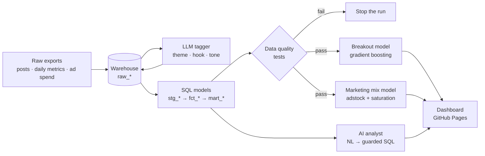

# Content Intelligence Platform

[](https://github.com/iRoPad/content-intelligence-platform/actions/workflows/ci.yml)


**End-to-end analytics and AI for a multi-brand social video network.** Raw platform exports go in; a tested SQL warehouse, LLM content tagging, a breakout prediction model, a marketing mix model, a natural-language "ask your data" analyst, and a live dashboard come out.

**[Live dashboard →](https://iRoPad.github.io/content-intelligence-platform/)** (rebuilt by CI on every push)

It answers the two questions a social content team argues about every week:

1. **What makes a post break out**, and can we tell before we publish it?
2. **Where should the next paid-media dollar go**, given carryover and diminishing returns?

```
$ python -m ciq run
[1/8] Generate synthetic raw exports ....... 5,967 post rows, 83,034 metric snapshots
[2/8] Land raw data in the warehouse
[3/8] AI content tagging ................... theme 70% | hook 99% | tone 71% (rules baseline)
[4/8] Build SQL staging + marts ............ 6 models
[5/8] Data quality tests ................... 9 blocking pass, 3 warnings tracked
[6/8] Train breakout prediction model ...... ROC-AUC 0.71, 2.6x lift in top decile
[7/8] Fit marketing mix model .............. R² 0.94, 2.2% holdout MAPE
[8/8] Render dashboard ..................... docs/index.html
pipeline finished in 7.3s
```

---

## Architecture



| Layer | What it does | Where |
|---|---|---|
| **Ingest** | Lands raw CSV exports untouched, with load metadata, plus a calendar dimension | `ciq/ingest.py` |
| **AI tagging** | Batched LLM classification of every caption into a fixed taxonomy, strict JSON contract, hash cache, rules fallback, evaluated against a labeled holdout | `ciq/tagging.py`, `ciq/llm.py` |
| **Transform** | dbt-style SQL models: dedupe, normalize, timezone-convert, build the post fact table, weekly marts and a model-ready MMM table. `{{ variables }}` keep business rules in one place | `sql/*.sql`, `ciq/transform.py` |
| **Data quality** | Uniqueness, accepted values, referential and range tests. Blocking failures stop the pipeline | `ciq/quality.py` |
| **ML** | Pre-publish breakout classifier with a time-based split, baseline comparison, permutation importance and an ablation that measures the AI tags' value | `ciq/model.py` |
| **MMM** | Geometric adstock + Hill saturation, coordinate-descent hyperparameter search, bounded least squares, ROI, marginal ROI and a constrained budget reallocation | `ciq/mmm.py` |
| **AI analyst** | Natural language → SQL with guardrails (single read-only SELECT, allow-listed tables, enforced LIMIT, read-only connection), then a plain-English answer | `ciq/analyst.py` |
| **Dashboard** | Self-contained HTML (no build step), light/dark, hover tooltips, deployed to GitHub Pages | `ciq/report.py`, `ciq/templates/` |

---

## Results

All numbers come from the default run (`seed=42`).

### What breaks out
A **breakout** is a post that reaches **2× the trailing average of the previous 30 posts** from the same brand on the same platform. Measuring against a trailing baseline keeps big accounts from dominating and guarantees the label never uses future data (there's a test for that).

- **Hooks matter most on TikTok.** Hot-take openers break out at **15.9%** vs **4.1%** for captions with no hook.
- **Creator collabs pay off.** Macro-creator collabs break out at **18.9%** vs **5.7%** for solo posts.
- **Length has a sweet spot.** On Instagram, 15–29s videos break out at **10.9%**; under 15s, **2.3%**.
- **Prime time (5–9pm PT)** consistently outperforms the rest of the day.

### Breakout model (holdout: last 16 weeks)
| Model | ROC-AUC | PR-AUC | Top-10% lift |
|---|---:|---:|---:|
| **Gradient boosting** | **0.710** | **0.204** | **2.6×** |
| Logistic regression | 0.688 | 0.185 | 2.4× |
| Gradient boosting, no AI tags | 0.663 | 0.130 | 1.9× |

The base rate is 7%, so the model's top decile is a short list of posts **2.6× more likely to break out** than average. Removing the AI-generated tags drops PR-AUC by a third, which is the business case for the tagging layer.

### AI tagging
The keyword-rules baseline gets **99% of hooks** right (hooks have obvious surface patterns) but only **~70% of themes and tones**: about a third of captions describe their content without any giveaway keyword ("first one to miss buys dinner" is a challenge; "how many players can you name who did…" is trivia). That gap is exactly where an LLM earns its cost. Run with an API key to compare (see below); the evaluation is built in.

### Marketing mix model
| Channel | Est. conversions per $1k | True value | Marginal per $1k |
|---|---:|---:|---:|
| Creator partnerships | 75.5 | 84.4 | 17.4 |
| YouTube ads | 36.7 | 30.1 | 16.0 |
| Meta ads | 34.4 | 26.2 | 17.2 |
| TikTok ads | 29.8 | 33.9 | 14.9 |
| Paid search | 27.3 | 23.6 | 7.8 |

The model explains 94% of weekly variance and is within **2.2%** on 13 held-out weeks. It correctly identifies creator partnerships as the most efficient channel and paid search as the most saturated (lowest marginal return). Reallocating the same $51k/week budget away from search adds **~0.8%** paid-driven conversions. That number is deliberately honest: the synthetic budget is already close to efficient, and a large claimed lift from a reallocation should make you suspicious.

Because the data is synthetic, the generator records the **true** channel effects, so the MMM can be checked against ground truth, which real-world MMMs never allow.

### AI analyst
```
$ python -m ciq ask "Which hook works best on TikTok?"

SQL:
  SELECT hook, COUNT(*) AS posts, ROUND(AVG(CAST(is_breakout AS DOUBLE)) * 100, 1) AS breakout_rate_pct, ...
  FROM fct_post_performance WHERE is_breakout IS NOT NULL AND platform = 'tiktok' GROUP BY hook ...

     hook  posts  breakout_rate_pct  avg_views
 hot_take    339               15.9    50725.0
 question    475                9.1    39858.0
countdown    335                8.7    44804.0
    story    342                5.6    40832.0
     none    758                4.1    32301.0

A: Best: hot_take at 15.9% breakout rate; weakest: none at 4.1% breakout rate.
```
With `ANTHROPIC_API_KEY` set, any free-form question works and the answer is written by the LLM from the result rows. Without a key, an intent router answers common questions with vetted SQL templates.

---

## Quickstart

```bash
git clone https://github.com/iRoPad/content-intelligence-platform.git
cd content-intelligence-platform
pip install -r requirements.txt

python -m ciq run                 # full pipeline, ~10 seconds
open docs/index.html              # the dashboard
python -m ciq ask "do creator collabs help?"
python -m unittest discover -s tests -v
```

Or with `make`: `make run`, `make test`, `make ask Q="what time should we post on shorts?"`.

### Turn on the LLM layer
```bash
export ANTHROPIC_API_KEY=sk-ant-...
export CIQ_LLM_MODEL=claude-sonnet-5-5   # optional, this is the default
python -m ciq run                        # tagging now uses the LLM, cached in warehouse/tag_cache.json
python -m ciq ask "which brand had the best engagement rate on reels last month?"
```
No SDK is needed; `ciq/llm.py` calls the Messages API with the standard library. Every LLM step degrades gracefully: a failed batch falls back to rules, and the tagger's accuracy report shows the source mix so you always know which path produced the tags.

### Run on DuckDB
The SQL sticks to the subset SQLite and DuckDB share. SQLite is the default (zero install); to use DuckDB:
```bash
pip install duckdb
CIQ_ENGINE=duckdb python -m ciq run
```

---

## Project structure
```
ciq/
  generate.py      synthetic, deliberately messy raw exports with planted effects
  ingest.py        land raw files + calendar dimension
  tagging.py       LLM / rules content tagger + evaluation
  llm.py           tiny Anthropic Messages API client (stdlib only)
  transform.py     SQL model runner with {{ variable }} templating
  quality.py       data tests that gate the run
  model.py         breakout classifier, ablation, permutation importance
  mmm.py           marketing mix model + budget optimizer
  analyst.py       NL -> SQL with guardrails
  report.py        renders docs/index.html
  templates/       dashboard template
sql/               01_stg_posts → 06_mart_mmm_weekly
tests/             guardrails, tagging contract, MMM math, warehouse integrity
.github/workflows/ CI: run pipeline, run tests, deploy dashboard to Pages
```

## Design decisions
- **Messy on purpose.** The raw exports contain duplicate rows from overlapping pulls, inconsistent platform names ("TikTok", "YOUTUBE", "Instagram "), missing durations and glitched negative metric snapshots, because that's what real API exports look like. Staging fixes them and tests prove it.
- **Leakage-free labels.** The breakout baseline uses `ROWS BETWEEN 30 PRECEDING AND 1 PRECEDING`, and the model trains on the past and tests on the most recent weeks.
- **Pre-publish features only.** The model scores a post before it goes live, so it can be used to plan a content calendar, not just explain the past.
- **Every AI step is measured.** The tagger is scored against labels, the model is ablated with and without the tags, and the MMM is checked against known truth. If the LLM doesn't beat the baseline, the numbers will say so.
- **AI with guardrails.** Generated SQL is validated before it touches the warehouse and runs on a read-only connection. Only the result rows go back to the LLM, never the raw tables.
- **Runs anywhere.** Standard library + pandas/NumPy/scikit-learn/SciPy. No API key, database server or build step required.

## Taking it to production
The same shape maps onto a production stack: platform APIs (TikTok, Instagram Graph, YouTube Analytics) on a scheduler such as Airflow or Cloud Scheduler instead of the generator, BigQuery or Snowflake instead of SQLite, dbt instead of the SQL runner (the models are already written dbt-style), a model registry for the classifier, and a Bayesian MMM (PyMC-Marketing or Meridian) when you need uncertainty intervals on channel ROI.

## About the data
All brands, posts and spend are synthetic. The generator plants realistic effects (hook type, theme × platform interactions, video length, posting hour, creator collabs, ad carryover and saturation) plus unpredictable "viral luck," so the analysis has real signal to find and real noise to fight. Change `CIQ_SEED` to generate a different world.

---

Built by **Roland Padilla**. Analytics and data engineering for social video, sports media and creator content.
